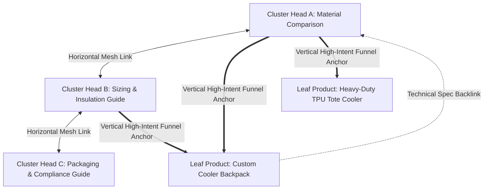

# B2B Question Keyword Clustering & GEO Growth Flywheel Engine

When tasked with scaling organic B2B search traffic, capturing Google AI Overviews / Perplexity citations, optimizing People Also Ask (PAA) real estate, or transforming real-world customer inquiries into high-converting content assets, you MUST execute the **B2B Question Keyword Clustering & GEO Growth Engine**.

This architecture operates on a proven 2026 paradigm shift: **search behavior has permanently transitioned from generic product keywords to nuanced decision-making questions**. Rather than competing for commoditized head terms, FidgetSupply captures and dominates high-intent commercial decision nodes through structured, entity-clustered content hubs.

---

```
+==================================================================================================+
|                        THE B2B QUESTION CLUSTERING & GEO GROWTH FLYWHEEL                         |
+==================================================================================================+
|  [ 1. Full-Domain Harvesting ] ---> [ 2. Intent Tiering ] ---> [ 3. Entity 2D Clustering ]       |
|  • 7 Unique Sources                 • Comparison (5-Star)      • [Core Entity] + [Intent]        |
|  • WhatsApp/Inquiry Logs (Moat)     • Procurement Specs        • Compress 10,000+ long-tail      |
|  • Amazon Q&A, Reddit, PAA          • Troubleshooting          • Into 40-80 Cluster Heads        |
|                                                                                                  |
|                                                                                                  |
|  [ 6. Continuous Flywheel ]   <--- [ 5. Traffic Funnel ] <--- [ 4. AI-Ready Content ]            |
|  • Ingest daily chat prompts        • Mesh Hub-to-Hub Links    • 40-word Direct Answer Block     |
|  • Enrich Living Entity Pool        • Leaf SKU Conversion      • H2/H3 Direct Conclusion First   |
|  • Update Skill dynamically         • Sample Kit + WhatsApp    • Decision Tables & Test Data     |
+==================================================================================================+
```

---

## 1. Pillar 1: Full-Domain 7-Source Harvesting Protocol

Generic SEO relies exclusively on third-party tools (Ahrefs/Semrush/Ubersuggest) to filter "What/How/Why" questions, resulting in homogeneous, commoditized content. FidgetSupply enforces **7-Source Full-Domain Harvesting**, prioritizing proprietary first-party channels:

| Priority | Source | Questions Harvested | Strategic Value & Moat |
| :--- | :--- | :--- | :--- |
| **P0 (Moat)** | **Customer Service, WhatsApp & Email Logs** | Repeated technical doubts, lead-time anxieties, mold cost queries, sample approval criteria. | **Highest Conversion Weight (100% Proprietary)**. These represent real purchase roadblocks from paying clients; competitors cannot access this data. |
| **P0 (Moat)** | **Material & Process Comparison (A vs B)** | e.g. *Soft enamel vs hard enamel*, *PEVA vs TPU cooler liner*, *Zinc alloy vs iron*. | **Highest Commercial Decision Value**. Buyers searching comparison terms have already decided to buy and are finalizing the Bill of Materials (BOM). |
| **P1** | **Amazon B2B & Retail Q&A Sections** | "Will the color run in wash?", "Does it pass FDA food grade?", "Does the magnet scratch painted stainless steel?". | **Last-Mile Purchase Hesitation**. Unfiltered pre-purchase friction points from enterprise and commercial buyers. |
| **P1** | **Reddit & Specialized Niche Forums** | Subreddits (`r/merch`, `r/enamelpins`, `r/streetwearstartup`, `r/supplychain`) containing unfiltered complaints and supplier horror stories. | **Authentic Failure Modes**. Captures colloquial phrasing, industry skepticism, and pricing transparency traps. |
| **P2** | **YouTube Technical Reviews & Comments** | Questions asked under competitor factory tours, sample unboxings, and QA testing videos. | **Unmet Technical Blind Spots**. Zero-cost buyer focus groups indicating what existing content failed to explain. |
| **P2** | **Google PAA (People Also Ask) & Autocomplete** | Mainstream algorithmic search questions and long-tail query fan-outs. | **Baseline Volume**. Broad coverage foundation, optimized for algorithmic presence. |
| **P3** | **Google Search Console (GSC) Query Long-Tail** | Questions where FidgetSupply impressions are growing but CTR is low (Striking Distance). | **Immediate Traffic Recovery**. Unlocks latent rankings by adding dedicated question-answer blocks to existing pages. |

---

## 2. Pillar 2: 4-Tier Intent Classification & Value Arbitrage

Not all question keywords carry equal commercial value. Every harvested query MUST be categorized into one of four intent tiers before resource allocation:

### Tier 1: Comparison & Selection Intent (★★★★★ — 60% Content Focus)
- **Typical Queries**: *"Soft PVC vs Acrylic fridge magnets for retail"*, *"PEVA vs TPU leakproof liner for cooler bags"*, *"600D Polyester vs 16oz Canvas durability"*.
- **Commercial Reality**: The buyer has passed the "do I need this?" phase. They are writing the production spec sheet and deciding between factory quotes.
- **Action**: Build comprehensive, Backlinko-grade comparison guides with side-by-side engineering tear-downs, lab pull/abrasion tests, and cost-per-unit delta analysis.

### Tier 2: Procurement & Spec Sizing Intent (★★★★☆ — 25% Content Focus)
- **Typical Queries**: *"Custom cooler bag insulation hours calculation"*, *"How to calculate custom lanyard width and safety breakaway specs"*, *"Enamel pin thickness vs mold cost"*.
- **Commercial Reality**: Mid-to-late stage decision-making. Buyer needs hard numbers, formulas, and MOQ price curves to submit to their internal procurement committee.
- **Action**: Deliver transparent pricing tables, turnaround timelines, and downloadable/actionable spec sheets, linking directly to leaf product SKU quotation pages.

### Tier 3: Quality Assurance & Troubleshooting Intent (★★★☆☆ — 10% Content Focus)
- **Typical Queries**: *"Why do zinc alloy keychains get plating bubbles?"*, *"How to prevent screen print cracking on canvas totes"*, *"Do fridge magnets damage painted appliances?"*.
- **Commercial Reality**: Post-purchase troubleshooting or pre-emptive risk mitigation. Establishes FidgetSupply as an ethical, audited, and transparent manufacturing partner.
- **Action**: Provide root-cause factory physics (humidity, curing temp, alloy purity) and explain FidgetSupply's AQL 2.5 quality controls.

### Tier 4: Informational & Awareness Intent (★★☆☆☆ — 5% Content Focus)
- **Typical Queries**: *"What is a lanyard"*, *"History of fridge magnets"*, *"What is plush toy filling made of"*.
- **Commercial Reality**: Low commercial intent, dominated by students or general consumers. High bounce rate and zero RFQ yield.
- **Action**: Minimize investment. Only deploy brief glossary snippets to support topical domain authority; never create standalone skyscraper guides for pure awareness terms.

---

## 3. Pillar 3: Entity + Intent 2D Clustering Matrix

Never create 1-to-1 pages for every single keyword. Doing so produces thin content, cannibalizes rankings, and exhausts engineering resources.

### The 2D Clustering Invariant
Group harvested queries strictly by:
$$\text{Cluster} = [\text{Core Manufacturing Entity}] \times [\text{Commercial Intent Tier}]$$

```
                              [ CORE ENTITY: Cooler Bags ]
                                           │
         ┌─────────────────────────────────┼─────────────────────────────────┐
         │                                 │                                 │
   [ Tier 1: Comparison ]           [ Tier 2: Sizing/Specs ]          [ Tier 3: QA/Failure ]
   "PEVA vs TPU Liners"             "Insulation Hours & Foam GSM"     "Seam Leaks & Odor Control"
         │                                 │                                 │
   Cluster Head #1                  Cluster Head #2                   Cluster Head #3
   (1 Comprehensive Guide)          (1 Comprehensive Guide)           (1 Comprehensive Guide)
   Absorbs 35 Long-Tail Queries     Absorbs 28 Long-Tail Queries      Absorbs 22 Long-Tail Queries
```

### Cluster Head Sizing Rules:
1. **Minimum Query Density**: A Cluster Head must absorb at least **15–30 long-tail query variants**.
2. **Topical Scope**: The Cluster Head title must represent the broadest decision-making question that naturally encompasses all sub-questions.
3. **Target Ratio**: Compress **1,000 raw harvested questions into 20–35 high-yield Cluster Heads**.

---

## 4. Pillar 4: AI & GEO-Ready Direct Answer Engineering

Generative AI search engines (Google AI Overviews, Perplexity, ChatGPT Search) and Google Featured Snippets extract content using strict structural heuristics. Every Cluster Head guide MUST implement the **AI-Ready Answer Stack**:

### 1. The 40-Word Direct Answer Invariant (Executive Briefing Block)
- **Position**: Immediately below the H1 and article meta, before the table of contents.
- **Format**: A clean, single paragraph between **30 and 45 words**.
- **Constraint**: Zero introductory throat-clearing (*"In today's fast-paced world..."*, *"When choosing materials, it is important to consider..."*). Must begin with a direct factual conclusion, technical parameter, and definitive recommendation.
- **Example**:
  > *"For heavy-duty cooler bags, TPU linings offer 100% welded leakproof durability and puncture resistance for marine environments, while food-grade PEVA provides reliable 6-8 hour cold retention at 25% lower manufacturing cost for corporate promotional wholesale."*

### 2. Immediate Comparison/Parameter Data Matrix
- **Position**: Placed directly below the 40-word direct answer block.
- **Format**: Responsive, multi-column HTML/Markdown table comparing the key entities across at least 5 empirical dimensions (Material Grade, Tensile/Puncture Rating, Temperature Range, Unit FOB Price Delta, Recommended Application).

### 3. H2/H3 "Conclusion-First" Sub-Heading Protocol
- When breaking down sub-questions in H2 or H3 sections:
  - **Sentence 1**: Bold direct conclusion answering the sub-question.
  - **Sentence 2–4**: Manufacturing physics, testing standards (ASTM, EN71, ISO), and factory-floor rationale.
  - **Sentence 5+**: Practical procurement recommendation and volume considerations.

### 4. Anti-Freeloading Conversion Capture
- Every Cluster Head guide MUST embed:
  1. **Inline Sample Kit & Digital Proof Desk Card** (`InsightSampleKitCard.astro`) midway through the reading flow, pre-populated with the relevant entity.
  2. **Dedicated WhatsApp floating CTA** for urgent custom inquiries.

---

## 5. Pillar 5: Topical Mesh Linking & Leaf SKU Conversion Funnel

Question clusters do not exist in isolation. They form a bidirectional web that funnels authority to leaf product pages and captures enterprise buyers:



### Invariants:
1. **Horizontal Mesh**: Every Cluster Head MUST link to 2–3 sibling Cluster Heads within the same product category (e.g. *Material Comparison* links to *Sizing Guide* and *Compliance Manual*).
2. **Vertical Funnel**: Every Cluster Head MUST include contextual, high-intent text links to 2–4 relevant **Leaf Product SKU pages** (`/products/[slug]/`), directing readers to place RFQs.
3. **Reverse SKU Anchor**: Corresponding Leaf Product SKU pages MUST link back to the Cluster Head under their Technical Specifications section (*"Evaluating materials? Review our engineering tear-down: PEVA vs TPU Liners ↗"*).

---

## 6. Pillar 6: The Continuous Conversation Evolution Flywheel

This Skill is not a static manual—it is an **autonomous, learning flywheel** that evolves with every user prompt, customer WhatsApp message, and trade conversation.

```
       ┌─────────────────────────────────────────────────────────────┐
       │                 USER PROMPT / CHAT INPUT                    │
       │  • User shares WhatsApp chat log with overseas buyer        │
       │  • User mentions new client question or objection          │
       │  • User reports emerging trend (e.g., eco-rPET requirement) │
       └──────────────────────────────┬──────────────────────────────┘
                                      │
                                      ▼
       ┌─────────────────────────────────────────────────────────────┐
       │           1. REAL-TIME DISTILLATION & MAPPING               │
       │  • Extract core entities, failure modes & buyer objections  │
       │  • Classify into Intent Tier (Comparison, Spec, QA, Info)   │
       └──────────────────────────────┬──────────────────────────────┘
                                      │
                                      ▼
       ┌─────────────────────────────────────────────────────────────┐
       │           2. REPOSITORY & ASSET EXPANSION                   │
       │  • If matches existing Cluster Head: Add as H3 sub-question │
       │  • If new high-value gap: Queue new Cluster Head guide      │
       │  • Sync 40-word direct answers and FAQ schema               │
       └──────────────────────────────┬──────────────────────────────┘
                                      │
                                      ▼
       ┌─────────────────────────────────────────────────────────────┐
       │           3. SKILL SELF-EVOLUTION & BACKFLOW                │
       │  • Update the Living Entity Database in this SKILL.md       │
       │  • Record newly discovered buyer phrasing in Question Moat  │
       │  • Commit updates to version control                        │
       └─────────────────────────────────────────────────────────────┘
```

### Autonomous Flywheel Execution Rules:
Whenever the user shares customer interactions, WhatsApp chat records, or trade insights during pair programming:
1. **Identify Unseen Entities & Doubts**: Instantly extract raw buyer questions (e.g. *"Can we print reflective ink on neoprene?"*).
2. **Attribute to Cluster Head**: Determine whether an existing Cluster Head covers the topic, or if a new Cluster Head is required.
3. **Execute Content Action**: Draft or update the corresponding `.md` guide in `src/content/insights/` following the 40-word direct answer standard.
4. **Persist Knowledge in Skill**: Append the new entity, failure mode, and question pattern to Section 7 (Living Entity & Question Moat Repository) of this file.

---

## 7. Living Entity & Question Moat Repository (FidgetSupply Core Categories)

*This repository is continuously updated by the conversation flywheel.*

### Category 1: Custom Drinkware & Insulated Cooler Bags
- **Core Entities**: PEVA liner, TPU liner, EPE foam, NBR closed-cell foam, 600D polyester, 840D TPU tarpaulin, copper vacuum insulation.
- **Top Comparison Cluster Heads**:
  - `PEVA vs TPU Cooler Liners`: Leakproof welding vs cost per unit (`/insights/peva-vs-tpu-cooler-bag-liners-b2b-guide`).
  - `EPE Foam (5mm vs 8mm vs 10mm)`: Cold retention hours curve (4h vs 12h vs 24h).
  - `Stainless Steel 304 vs 316 for Corporate Tumblers`: Acid resistance for coffee/citrus beverages.
- **Proprietary Customer Questions (From WhatsApp/Inquiries)**:
  - *"Will melted ice water leak through the bottom zipper if inverted?"*
  - *"Can TPU liners pass European LFGB food-grade testing without volatile odor?"*
  - *"Why do some cheap cooler bags develop foul chemical odors after storage in a hot car?"*
  - *"Can custom cooler bags hold dry ice without cracking the interior liner (-78.5°C threshold)?"*

### Category 2: Enamel Pins, Medals & Metal Keychains
- **Core Entities**: Soft enamel, hard enamel (cloisonné), zinc alloy, die-struck iron, antique brass, epoxy dome coating.
- **Top Comparison Cluster Heads**:
  - `Soft Enamel vs Hard Enamel Pins`: Recessed textured feel vs flat polished mirror finish (`/insights/insights/hard-vs-soft-enamel`).
  - `Zinc Alloy vs Iron Die-Struck`: 3D relief capability vs unit weight and cost at 5,000+ pcs.
  - `Keychain Plating Durability`: Nickel vs real gold vs electrophoresis black (salt spray hours).
- **Proprietary Customer Questions (From WhatsApp/Inquiries)**:
  - *"Why did our last supplier's badges have pin-posts fall off during shipping (soldering vs gluing)?"*
  - *"Can hard enamel replicate thin CMYK gradients without metal separating lines?"*
  - *"Why is hard enamel 20–30% more expensive to manufacture than soft enamel?"*
  - *"Which enamel style is better for reproducing intricate corporate logos with fine lines (0.15mm vs 0.25mm)?"*

### Category 3: Custom Fridge Magnets & Acrylic Novelties
- **Core Entities**: Flexible rubber magnet (0.5mm vs 1.0mm), isotropic vs anisotropic, soft PVC, cast acrylic, tinplate.
- **Top Comparison Cluster Heads**:
  - `Soft PVC vs Acrylic Fridge Magnets`: Tactile relief vs photo-print sharpness & zero mold fees (`/insights/soft-pvc-vs-acrylic-fridge-magnets-b2b-guide`).
  - `Soft PVC vs Metal Fridge Magnets`: Tactile relief vs jewelry permanence (`/insights/soft-pvc-vs-metal-fridge-magnets-b2b-comparison`).
  - `0.5mm vs 1.0mm Magnet Pull Force`: Holding 1 sheet of paper vs 5 takeout menus without sliding.
  - `Acrylic Magnet UV Printing vs Interlayer Sandwich`: Surface scratch resistance on household appliances.
- **Proprietary Customer Questions (From WhatsApp/Inquiries)**:
  - *"Will flexible rubber magnets leave black scuff marks on white powder-coated refrigerators?"*
  - *"Do acrylic fridge magnets scratch stainless steel or painted refrigerators?"*
  - *"Can soft PVC magnets reproduce photographic images or fine gradients?"*
  - *"Why do acrylic fridge magnets have zero mold tooling charges ($0 vs $150-$250)?"*
  - *"How can buyers test fridge magnet pull force before placing a large volume order?"*

### Category 4: Custom Bags, Backpacks & Carrying Solutions
- **Core Entities**: 12oz canvas, 16oz duck canvas, organic jute, Juco, 210D polyester, 600D Oxford, RPET recycled fabrics.
- **Top Comparison Cluster Heads**:
  - `Jute vs Cotton vs Canvas Totes`: Eco-sustainability credentials, rough texture vs fine screen printing, price tiers.
  - `12oz vs 16oz Canvas Load-Bearing`: Handle cross-stitching failure thresholds (8kg vs 25kg).
  - `Anti-Theft Laptop Backpack Materials`: Cut-proof wire mesh vs high-density Oxford water repellency.
- **Proprietary Customer Questions (From WhatsApp/Inquiries)**:
  - *"How much will 100% natural cotton shrink after the first commercial wash?"*
  - *"Can unlaminated jute bags handle detailed 4-color screen logos without ink bleeding?"*

### Category 5: Custom Lanyards & Wearable Accessories
- **Core Entities**: Flat polyester, tubular polyester, ribbed nylon, dye-sublimation satin, eco-bamboo fiber, safety breakaway buckle.
- **Top Comparison Cluster Heads**:
  - `Polyester vs Nylon vs Dye-Sublimation Lanyards`: Cost efficiency vs silky sheen vs full-color edge-to-edge printing.
  - `Safety Breakaway Attachments`: Plastic quick-release vs quick-snap neck clasp for occupational safety compliance.
  - `Silicone vs Woven vs Fabric Wristbands`: Multi-day music festival durability vs single-use RFID security.
- **Proprietary Customer Questions (From WhatsApp/Inquiries)**:
  - *"What is the minimum lanyard width to prevent the badge from flipping backward while walking?"*
  - *"Are safety breakaways mandatory for school and hospital procurement orders in the US/EU?"*

### Category 6: Custom Plush Toys, Mascots & Pet Products
- **Core Entities**: Crystal super-soft velboa, PV fleece, PP cotton, recycled GRS polyester filling, TPR rubber, natural rubber.
- **Top Comparison Cluster Heads**:
  - `Natural Rubber vs TPR Dog Chew Toys`: Puncture elasticity vs heavy power-chewer durability.
  - `Custom Plush Embroidered Eyes vs Plastic Safety Eyes`: 0+ infant EN71-1 choking hazard compliance vs aesthetic appeal.
  - `Custom Pet Bandanas (Cotton vs Polyester)`: Breathability and cooling vs sublimation vibrancy and wrinkle resistance.
- **Proprietary Customer Questions (From WhatsApp/Inquiries)**:
  - *"Can plush toys pass needle detection if there is a metal rattle or squeaker inside?"*
  - *"What certificates do we need for custom dog toys to sell on Amazon US and Chewy (ASTM F963 / Prop 65)?"*

---

## 8. Continuous Evolution Checklist (Flywheel Trigger)

When the user says:
- *"客户在 WhatsApp 上问了这个问题..."*
- *"把这个客户提问沉淀到我们的问答库"*
- *"根据这篇文章更新我们的问答集群打法"*
- *"帮我把这个对比写成博客，并更新 Skill"*

You MUST:
1. **Extract & Classify**: Identify Entity + Intent Tier + Customer Phrasing.
2. **Produce & Integrate**: Generate or refine the Backlinko-grade content guide with a 40-word direct answer block.
3. **Persist & Evolve**: Append the new insights, questions, and parameters directly into Section 7 of this `SKILL.md` file using `replace_file_content`.
